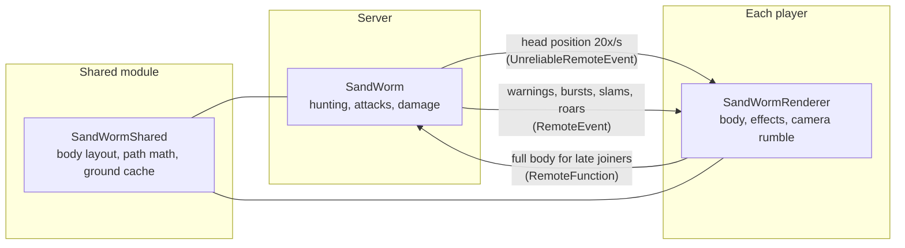

# Luau Gameplay Systems

Gameplay systems from an independent multiplayer game I'm building in Roblox Studio. Everything here is written in Luau and runs in the game; the creature models and animations it drives are my own, made in Blender.

| System | Files | What it does |
| --- | --- | --- |
| **Sandworm boss** | [`SandWorm.server.luau`](src/server/SandWorm.server.luau), [`SandWormShared.luau`](src/shared/SandWormShared.luau), [`SandWormRenderer.client.luau`](src/client/SandWormRenderer.client.luau) | A boss that swims under the terrain, hunts players and attacks with a bite, a head smack and a tail whip. |
| **Storm weather** | [`WeatherZones.server.luau`](src/server/WeatherZones.server.luau), [`StormWeather.client.luau`](src/client/StormWeather.client.luau) | Sandstorm and snowstorm zones drawn on each player's device around their camera. |
| **Frost Brute AI** | [`BruteSpawner.server.luau`](src/server/BruteSpawner.server.luau) | A zone-locked enemy with aggro, leashing, a roar and four weighted attacks with timed hitboxes. |

## Sandworm boss

The server decides where the worm goes and when it attacks. Players only receive the head's position, and each player's device builds the 58-part body from it.

- **Body on a path.** The head moves along a path and every ring, fin and the tail sits a fixed distance behind it, like train cars on a track. An "up" direction is carried along the path, so the spine fins stay on the worm's back through climbs and dives without flipping.
- **Server-authoritative.** All damage runs through the game's normal damage pipeline on the server, so blocking, the safe zone, stun and knockback work like every other attack. The client only draws.
- **Hitboxes match visuals.** Server and client use the same shared module, so hitboxes sit exactly where players see the body.
- **Hunting.** It targets the top player on the kills leaderboard first, then works down the list, never repeating the same attack twice in a row.
- **Warnings players can read.** Deep underground it shows only a wake. Closer, its fins break the ground. Right before an attack, the ground cracks where it will hit.
- **Late joiners.** A player who joins mid-fight gets the whole body from the server in one request.

## Storm weather

The server only publishes each zone's outline. Each player's device draws the storm around its own camera with a few particle layers, and blends the sky and colour grade toward tan or icy white.

- Storm strength fades in past the zone edge, calms near the safe zone, drops under a roof, and blends where the sand and snow zones meet.
- Particles are either tiny (grains, flakes, hairline streaks) or huge and faint (dust waves), so none of them read as floating shapes.
- Particle counts scale with the player's graphics level; phones and tablets are capped at half.

## Performance work

Measured in Studio playtests on a laptop, before and after each rebuild.

| | Before | After |
| --- | --- | --- |
| Storm particle emitters on every client | 11,340 | 8 (client-side, around the camera) |
| FPS in the snowstorm (storm on vs off) | 32.7 vs 60.0 | 60.0 vs 60.0 |
| FPS in the sandstorm (storm on vs off) | 42.4 vs 54.6 | 59.2 vs 59.4 |
| Worst client frame while the worm attacks | 117 ms | 53 ms |
| Moving worm parts casting shadows | 28 | 0 |
| One terrain height check | 16.5 µs (long raycast) | 2.5 µs (cached per 2×2-stud cell) |
| Server time spent on ground checks | 7.3 ms per second | 0.4 ms per second |

## Notes

- Folder layout mirrors where each script lives in Studio (`server` = ServerScriptService, `client` = StarterPlayerScripts, `shared` = ReplicatedStorage).
- The scripts plug into the game's own combat, zone, kill-tracking and XP modules, which aren't included, so this is a code sample rather than a drop-in package.
